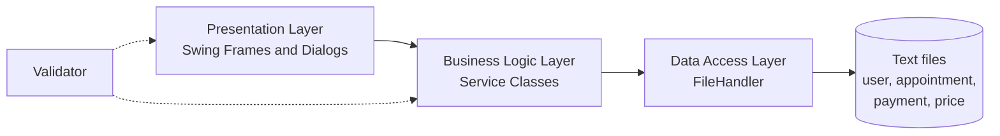
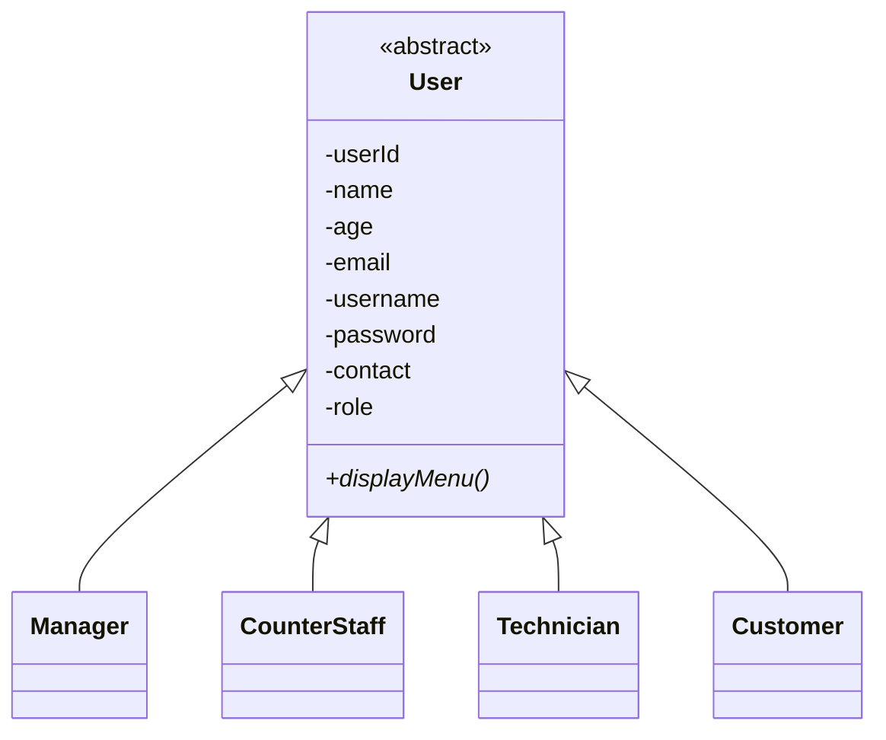

<div align="center">

# 🚗 APU Automotive Service Centre (APU-ASC)

### A role-based Java Swing desktop system that digitalises the daily operations of an automotive service centre


**4 user roles · 25 use cases · 14 extra features · 3-tier architecture · all 4 OOP pillars**

</div>

---

## 📖 About

**APU-ASC** manages the full workflow of an automotive service centre: customer registration, appointment scheduling, job tracking, payment collection, receipts, staff management and business reporting, all through a clean, role-based graphical interface.

Each user type signs in through one login screen and is routed to a dedicated dashboard with its own set of features. Database tools were not permitted for this assignment, so all data is persisted in plain text files through a centralised file-handling layer.

> 🎓 **Academic project.** Built as a group assignment for *Object Oriented Development with Java* at Asia Pacific University of Technology and Innovation (APU), 2026.

---

## ✨ Features by Role

| Role | What they can do |
|---|---|
| 👔 **Manager** | Add, edit and delete staff · Set service prices · View customer feedback · Reports and statistics · View all appointments · Technician performance · View all payments · System statistics with bar charts · Dashboard overview cards |
| 🧾 **Counter Staff** | Add, edit and delete customers · Create appointments · Collect payments · Generate receipts · Search appointments · Daily summary export · Edit own profile |
| 🔧 **Technician** | Dashboard · View assigned jobs and job details · Update job status (mark completed) · Submit job feedback · Weekly schedule · Job history with date filter · Personal performance · Edit own profile |
| 🙋 **Customer** | Dashboard · View and cancel appointments · Submit feedback · Payment history · Service history · View receipts · Edit own profile |

### 🌟 Highlights

- **One login, four dashboards.** Runtime type resolution routes each user to the right frame (`Manager_Frame`, `CS_Frame`, `Technician` frame or `Customer` frame).
- **Central input validation.** A single `Validator` class checks every form (IDs, name, age, email, username, password, contact) and shows inline error messages without closing the dialog.
- **Live statistics.** Manager dashboards show real-time stat cards and bar charts for appointments by month, revenue, peak hours and technician workload.
- **Smart scheduling views.** Technicians get a weekly schedule built with `java.time` and a date-filtered job history.
- **Exportable daily summary.** Counter staff can generate and export a daily summary report.

---

## 🏗️ Architecture

The system follows a **three-tier architecture** that keeps the UI, business rules and data access cleanly separated.



| Layer | Classes | Responsibility |
|---|---|---|
| **Presentation** | `Login_Frame`, `Manager_Frame`, `CS_Frame`, Technician and Customer frames and dialogs | Swing screens, user input, displaying results |
| **Business logic** | `ManagerService`, `CounterStaffService`, `TechnicianService`, `CustomerService` | Rules, calculations, statistics, receipts |
| **Data access** | `FileHandler` | Reading and writing every text file |
| **Model** | `User`, `Manager`, `CounterStaff`, `Technician`, `Customer`, `Appointment`, `Payment` | Domain objects |
| **Utility** | `Validator` | Centralised input validation |

---

## 🧬 Object-Oriented Design

All four OOP pillars are applied and documented in the project report.



| Pillar | How it is used |
|---|---|
| **Inheritance** | The abstract `User` class holds the 8 shared fields, and `Manager`, `CounterStaff`, `Technician` and `Customer` extend it, passing a fixed role to `super(...)`. |
| **Encapsulation** | All fields are `private` and accessed only through getters and setters. |
| **Abstraction** | `User` cannot be instantiated, and the service layer hides file-handling and business logic from the UI. |
| **Polymorphism** | Login resolves the user's concrete type at runtime (`instanceof`), and one `ArrayList<User>` holds all four role types together. |

---

## 💾 Data Storage

All data is stored as comma-separated text files, read and written only through `FileHandler`.

| File | Contents |
|---|---|
| `user.txt` | All accounts for the four roles |
| `appointment.txt` | Appointments, status and job feedback |
| `payment.txt` | Payment records |
| `price.txt` | Service prices set by the Manager |
| `dailysummery.txt` | Exported daily summary |

---

## 🚀 Getting Started

### Prerequisites

- **JDK 14 or later** (the code uses switch expressions; JDK 17+ recommended)
- Any Java IDE such as Apache NetBeans, IntelliJ IDEA or Eclipse (optional)

### Run with an IDE

1. Clone the repository
   ```bash
   git clone https://github.com/Hazik-Allaie/<your-repo-name>.git
   ```
2. Open the project in your IDE.
3. Make sure the data text files (`user.txt`, `appointment.txt`, `payment.txt`, `price.txt`) are in the working directory the program reads from.
4. Run `Main.java` and sign in with an account from `user.txt`.

### Run from the command line

```bash
# compile every source file into ./out
javac -d out $(find . -name "*.java")

# launch the app
java -cp out Main
```

---

## 🖼️ Screenshots

> Add your screenshots to a `docs/screenshots/` folder and update the paths below.

| Login | Manager Dashboard |
|---|---|
|  |  |

| Technician Schedule | Counter Staff Receipt |
|---|---|
|  |  |

---

## ⚠️ Known Limitations

Documented honestly in the project report:

- **Plain-text passwords.** Passwords are stored and compared without hashing or encryption.
- **CSV fragility.** A comma typed into a free-text field (vehicle details, comments, feedback) can corrupt a record when it is parsed.
- **No concurrency control.** Flat files have no locking, so simultaneous edits can overwrite each other.
- **Non-atomic ID generation.** IDs are produced by scanning for the highest existing ID, so two simultaneous operations could create a duplicate.
- **Current-week schedule only.** The technician weekly schedule cannot navigate to other weeks.
- **Leftover console code.** The abstract `displayMenu()` method is a remnant of a console design and has no function in the Swing UI.

## 🛣️ Roadmap

- [ ] Replace text files with a relational database through JDBC
- [ ] Hash passwords (for example with BCrypt)
- [ ] Add JUnit tests for the service layer and `Validator`
- [ ] Add week navigation to the technician schedule
- [ ] Add file or row locking, or move to transactional storage

---

## 👥 Team

| Member | Contribution |
|---|---|
| **Mohammad Hazik Allaie** | Manager module (staff, pricing, feedback, reports, statistics) · Customer features (shared) |
| **Syed Muhammad Bilal Umar** | Counter Staff module · Customer features (shared) |
| **Sana Syed** | Technician module · Customer features (shared) |

---

## 🛠️ Built With

- **Java** (OOP, Collections, `java.time`, File I/O, exception handling with try-catch)
- **Java Swing and AWT** for the graphical interface

---

<div align="center">

**Asia Pacific University of Technology and Innovation (APU)** · Object Oriented Development with Java · 2026

⭐ If you found this project interesting, consider giving it a star.

</div>
